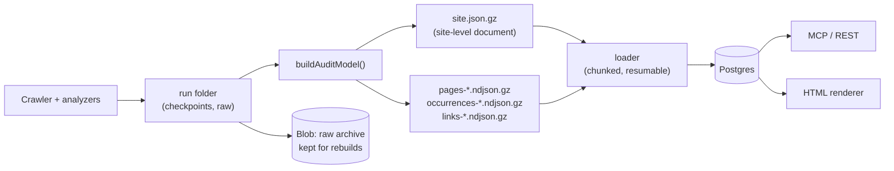
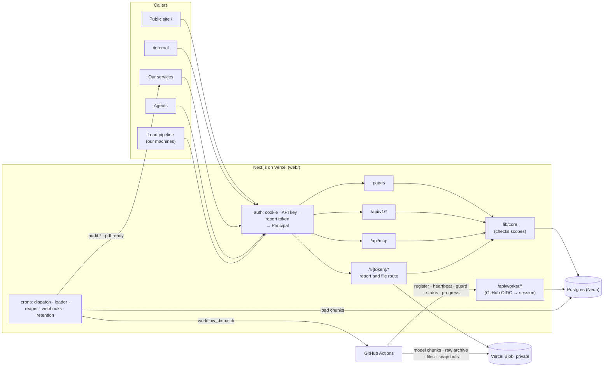
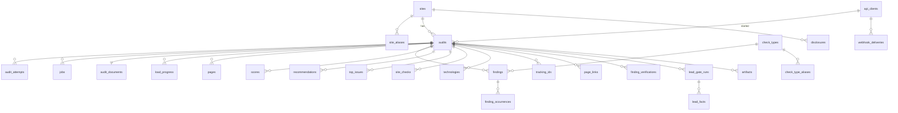

# Audit platform: public site, internal app, API and MCP server

Status: design, 2026-11-21, revision 5 (after four reviews; scope cut to the first consumer, §11 lists what waits). Nothing here is built yet.

## 1. Goals

| Surface | Who | What it can run | Auth |
|---|---|---|---|
| Public site, `/` (default URL) | Anyone | Quick scan, Single page | None (bot check + rate limits) |
| Internal app, `/internal` | FR team | Everything: full audit, presets, perf, LLM, verify, content research | Password → session cookie |
| MCP server, `/api/mcp` | Any of our services: scripts, LLM agents, a CRM sync, batch jobs (lead enrichment first) | Start any audit the key allows; read results | API key (bearer), scoped |
| REST API, `/api/v1` | The lead pipeline now; other services later (§11) | A few routes now (§6); the full mirror of MCP later | Same keys |

Design rules:

1. **One service layer.** MCP tools, REST routes and both web UIs call the same functions in `web/lib/core/`. Every core function takes a `Principal` and checks scopes itself; middleware only redirects.
2. **The server decides what a caller may run and see**, never the form. Public requests are forced to `quick` or `page` with fixed options.
3. **One audit model.** The engine hands its result to everyone as one typed, versioned model, never as raw run files (§2).
4. **Postgres holds the data.** Site-level results are one small document per audit; page-level data, occurrences and link edges are rows. Blob (private) holds binary files, the raw run archive and checkpoint snapshots.
5. **Results are frozen; later checks are appended.** Phase 3 verification and truth-gate runs go in append-only tables.
6. **Callers can be anything.** A consumer may be a script, an LLM agent, a CRM sync or a batch job. So nothing in the API assumes a particular one: results are plain typed data with documented fields, a caller that cannot receive a webhook can wait or poll, and every tool describes itself well enough for an agent to pick it.
7. **Every API key is ours.** Until an outside client exists, all API keys and the internal app see everything, and public visitors see only audits the public site started. Those audits hold nothing sensitive, because the public profile does not run the two security checks (§8.1). Per-caller filtering waits (§11).
8. **Audit runs stay on GitHub Actions** for now. The long-term goal is everything on Vercel; the worker is replaceable (§3).

## 2. One audit model

### The problem today

The run folder (`manifest`, `metadata`, `analysis`, `pages/`, `lead/` as `*.json.gz`) is the only contract, and each consumer parses it on its own:

| Consumer | Reads |
|---|---|
| HTML report | `ReportDataProcessor.loadAuditData` (`lib/reports/data-processor.ts`), plus three direct reads of `metadata.json.gz` in `generateHTML.ts` |
| CSV | `generateCSV.ts` |
| History and comparison | `historyManager.ts`, a separate `audit-history.json.gz` per domain |
| Phase 2 / Phase 3 | `lib/phase2/phase2-runner.ts`, `lib/phase3/verify-runner.ts`, `lib/phase3/finding-verifier.ts` |
| Lead gate | `lib/leads/run-data.ts`, `lib/leads/run-audit.ts` |
| Others | `start.ts`, `lib/orchestrators/single-page.ts`, `lib/scoring/fix-recommendations-extended.ts`, the web `view` routes |

The files are raw analyzer output (`PageInfo` has ~190 fields) and findings are keyed by their title text.

### The fix



- **`AuditModel`** (`lib/model/`, zod schemas, `modelVersion`) has two parts:
  - **Site part**, one document (`audit_documents`): audit info, scan quality, site profile (languages, AI crawler rules, llms.txt, Schema.org types, HTTP version, CDN, security headers, forms, CTAs, booking links, homepage screenshot), scores, quick wins and fix recommendations, the ranked top issues as the report shows them, Phase 2 narrative text, findings (code, `params`, counts, no occurrence lists), site checks, technologies and vendors, tracking IDs, field metrics, lab-metrics summary, sitemap and robots summary, lead-scan info, Phase 4 content research, `--repo` results, artifact list. Tens of KB for a quick scan, low MB for the largest full audit.
  - **Row parts**, written as NDJSON chunks: one record per page (core fields plus typed per-analyzer sections), every finding occurrence, link edges, redirects, hreflang links, sitemap entries, lab metrics per page.

  Measured: raw JSON of large full audits is already 12 MB (abilio.com) and 25 MB (themeateater.com) gzipped, so one document per audit would be far too big to decompress on every read. The split keeps every read small: a page read touches one row.
- **`buildAuditModel(runFolder)`** runs once at the end of an audit, in the worker. It is the only code that knows raw analyzer shapes. It reshapes what the run computed: it never re-runs an analyzer, never changes a severity and does not score.
- **The loader** (§3) inserts the chunks in batches, each in its own transaction, idempotent per chunk, and flips the audit to `succeeded` only after the last one. Readers only see succeeded audits, so a half-loaded audit is never visible.
- **Findings are computed once**, by the run. **Scores** start as the run's own; when the scoring code version changes, `rescore` re-computes the stored scores from the stored run data and writes the `scores` rows, the site document and the audit's scoring version in one transaction. The renderer, the PDF, the tables and every consumer show the same numbers.
- **Locally** the same model is written next to the run folder (`model/`); the CLI needs no database.
- **Consumers move to the model over time**: renderer, then CSV, history/comparison (becomes a query; `audit-history.json.gz` goes away), Phase 2/3 and the lead gate.

### Model versions

- The **raw run archive** (the run folder's `*.json.gz` and report text, without screenshots and evidence) is kept in Blob for every audit and never expires. Large full audits are 12–25 MB; quick scans much less. It is what makes a later rebuild possible.
- **Additive changes** (a new optional field) bump the minor version. Readers accept every minor version of the current major; a missing field reads as absent.
- **Version skew.** The worker runs from `main` and can be ahead of the deployed web app. The loader refuses a model major version the app does not know: the audit stays `built` with `load_blocked = model_version`, an alert is raised, and it loads after the next deploy. This wait does not count as a failed attempt.
- **Rebuilding old audits** (a new field filled for old audits, or a breaking change) is not built now (§11). Until it is, there are no major bumps.

### Every field is reachable

Typed tools cover the common questions. For everything else, which matters most to agents and scripts that ask things nobody planned for (§10 step 6):

- `describe_model` returns the schema (site document and page record: sections, fields, types, descriptions), generated from the zod schemas.
- `get_audit_data` returns part of an audit: a `path` in the site document (e.g. `robots.aiCrawlers`), or sections of one page record (`page_url` + `sections`, e.g. `contentQuality`). Paged and size-capped.

A path that is read often, or filtered on across audits, becomes a column, a table or a typed tool.

### HTML report from Postgres

The web app renders the report from the site document plus the page rows it needs. First:

1. **The renderer reads only the model.** Today `ReportDataProcessor` computes segments, page matching, history and field-performance at render time and reads files. Those computations move into `buildAuditModel`; history comes from the tables.
2. **The renderer is a pure function** (model in, HTML out): no `fs`, no `playwright`. Today `lib/reports` inlines screenshots read from disk as base64 (`lib/reports/sections/ui-issues.ts`) and imports `pdf-renderer.ts`. Screenshots become relative links (`a/{artifact}`, §7); PDF printing stays in a worker job. The renderer moves to a shared package used by the CLI and `web/`.

The rendered page is cached by `audit_id` + renderer version + view options. It holds no expiring URLs. Each PDF records the renderer version it was made with.

Until this is done (§10 step 7) the worker renders the HTML report as today and uploads it as an artifact.

### PDFs: only on request

No PDF is generated by default: not the Phase 2 report, not the Phase 3 verified report, not the Phase 4 content-research report, not the teaser.

- **At run time:** `pdf: true` (`--pdf` on the CLI, a checkbox in the internal form, `options.pdf` in `start_audit`).
- **Later:** `request_pdf` (MCP) or "Generate PDF" on the internal run page. This queues a `render-pdf` job (`jobs` table, §4) that restores the report text from the raw archive and the images from Blob, prints, and stores the PDF. Report text never expires, so a PDF can always be made; if the screenshots have expired (§9) the PDF is printed without them and says so.
- Phases 2–4 still write Markdown and HTML by default.
- The public site offers no PDF.

## 3. Architecture



**Queue.** `start_audit` inserts an `audits` row (`queued`) and returns. Queued rows are dispatched to GitHub oldest first, within a cap per source (public small, API medium, internal reserved), by the request itself when capacity is free and by a cron otherwise. The scan guard (§4) is checked again at dispatch. GitHub API errors leave the row queued. GitHub Actions concurrency and minutes are the real cost limit: a full audit can hold a job for up to 350 min.

**Crons.** Every cron takes a Postgres advisory lock for the row it works on (per audit for the loader and the reaper, per delivery for webhooks), so a cron that fires twice or overlaps itself does no double work.

**Worker auth (no secrets passed).** The workflow has `id-token: write`.

- At dispatch the app creates the attempt and a one-use `dispatch_nonce`, passed as a workflow input. It is not a secret: it only says which attempt this run is for.
- The worker's first call, `POST /api/worker/register {audit_id, attempt, nonce}`, sends GitHub's OIDC token, requested with our own audience. The app checks audience, issuer, repository, workflow file, ref and event (`workflow_dispatch`), that the nonce matches the audit's current attempt, and that the attempt is not bound yet. It then binds GitHub's `run_id` **and** `run_attempt` to the attempt. A "Re-run job" in the GitHub UI has a higher `run_attempt` and is refused.
- `register` returns a **session token** for that attempt (random, stored hashed, dead when the attempt ends). Heartbeat, status, progress and guard calls use it, because GitHub's OIDC token lives only minutes and a job runs for hours.
- A redispatch creates a new attempt; calls from an older runner are refused (409), and a runner that gets a 409 stops at once.
- People with write access to the repository can change the workflow itself, so they are trusted; the checks above are against everyone else.

**Blob paths carry the attempt.** The worker writes to `audits/{id}/{attempt}/…` and `checkpoints/{id}/{attempt}/…` with upload tokens the app issues to that attempt's session. The loader reads only the attempt that reported `built`, so an older runner that is still alive cannot mix its files into the result. A redispatched attempt gets read access to the previous attempt's snapshot.

**Saving a run.** At the end the worker writes the model chunks, the raw archive and the binary files to Blob and reports `built`. The loader cron takes chunk after chunk until its time budget is used (about 4 min per invocation), each chunk in its own transaction (delete this audit's rows with that chunk number, insert, record the chunk done). A timeout or crash resumes at the next chunk, and a large audit loads in a few invocations. After the last chunk it sets `succeeded`. A loader failure never touches the worker. The loader is a Vercel function, so it already fits the Vercel move.

**Heartbeat and reaper.** The workflow runs a background loop that calls `heartbeat` every 60 s for the whole job, independent of crawl progress, so long site checks, Phase 2–4 or PageSpeed runs stay alive. The reaper cron:

- `dispatched` with no `register` within 15 min → ask GitHub for the run (its name carries the audit id). Still waiting for a runner: leave it. Missing or failed: redispatch;
- `running` with `heartbeat_at` older than 10 min → `stalled`, cancel the GitHub run, redispatch with `resume_from_snapshot`;
- `built` or `loading` with no new `load_progress` row for 30 min and no `load_blocked` reason → retry the loader;
- at most 2 redispatches, then `failed`.

`render-pdf` jobs use the same register, session and heartbeat path, bound to a `jobs` row instead of an attempt.

### Writes during a run

Today: the crawler writes a checkpoint every 5 batches (`CRAWL_SETTINGS.CHECKPOINT_SAVE_INTERVAL`), moves pages to `pages/batch-N.json.gz` files of 100 (`BATCH_SIZE`), and flushes early above 500 pages in memory. `ProgressReporter` writes the progress file every 2 s; the workflow uploads it to Blob every 20 s. Checkpoints live on the runner's disk, so a dead job loses them.

| Data | Where | When |
|---|---|---|
| Raw checkpoint | Worker disk | As today; only for `--proceed` |
| Checkpoint snapshot | Blob, `checkpoints/{id}/{attempt}/`, content-addressed files + a manifest | After a checkpoint save completes (never mid-write), at most every 10 min, and at phase ends. Only files whose hash changed are uploaded, so evidence goes up once. Deleted after success |
| Heartbeat | `audit_attempts.heartbeat_at` | Every 60 s |
| Status | `audits` row | On each change: `queued` → `dispatched` → `running` → phase → `built` → `loading` → `succeeded` / `failed` / `cancelled` / `stalled` |
| Phase | `audits.phase` | `crawl`, `site-checks`, `fingerprint`, `gate`, `report`, `phase2`, `verify`, `content-research`, `pdf` |
| Progress | `audits` row, one `UPDATE` | At most every 15 s |
| Model chunks, raw archive, binary files | Blob, `audits/{id}/{attempt}/` | Once, at the end |
| Rows | Postgres, via the loader | After `built`, chunk by chunk |

A redispatched job restores the snapshot to the folder `FileManager` looks for (`audit-results/<domain>/<ts>/` or `lead-results/`) and runs with `--proceed`.

## 4. Data model

Postgres, schema in `web/db/schema.ts` (Drizzle, SQL migrations in git). Readers only see audits with `status = succeeded`. The step that creates each table is in §10.



### Sites and prospects

| Table | Key columns | Notes |
|---|---|---|
| `sites` | `id`, `host` (lower-case, as served), `registrable_domain` (eTLD+1 from the Public Suffix List, private section included, so `acme.github.io` is its own domain), `first_seen_at`, `deletion_pending_at` null | `www.acme.com` and `acme.com` are aliases, not merged by rule |
| `site_aliases` | `host`, `site_id`, `reason` (`redirect`/`www`/`manual`) | Filled when a homepage redirects; lookups by any alias find the site |
| `prospects` | `id`, `company`, `registrable_domains` text[], `fit_score`, `stage`, `stage_at`, `do_not_contact`, `has_audit` (`yes`/`failed`/null), `owner`, `notes` | The only prospect store (imported once from `docs/gtm/companies.csv`; the CSV becomes an export). Matched to sites by registrable domain; a company can have several sites. The CSV's `disclosed` column is replaced by the `disclosures` table |
| `suppressed_domains` | `registrable_domain`, `reason` (`owner_request`/`legal`), `created_at` | Set when a site owner asks us to delete their data; blocks every future scan. The request is confirmed first: a reply from an address on that domain, or a DNS TXT record we ask for |

**Scan guard.** One function decides whether a domain may be scanned: its registrable domain (and every known alias's) must not be in `prospects` with `do_not_contact`, nor in `suppressed_domains`. There is no override: `do_not_contact` is permanent (`sales-audit-system.md` §13) and a suppression stays until we remove the row by hand. The guard runs:

- before an audit is queued, from any source including the public form (API callers get `do_not_contact`, public visitors a neutral "this site can't be scanned");
- again at dispatch, so a domain guarded while its audit waited does not run;
- during the run: when the homepage lands on another registrable domain, the worker asks `POST /api/worker/guard` before it loads anything else; a refusal ends the audit as `cancelled` (`scan_guard`) and nothing is stored;
- in the lead pipeline: `GET /api/v1/guard?domain=` before `fingerprint` and before `scan`, and `POST /audits/import` refuses a guarded domain.

**Prospects get passive audits.** A full audit of a domain that is in `prospects` runs with `--passive` unless the request says `active: true`, which only the internal app can send, for a site whose owner agreed; it is logged.

### Audits

| Table | Key columns | Notes |
|---|---|---|
| `audits` | `id` (UUID), `legacy_run_id` null, `site_id`, `mode` (`full`/`quick`/`page`), `target_url`, `preset`, `options` jsonb, `profile` (`public`/`standard`), `profile_hash`, `comparable_key`, `status`, `phase`, `load_blocked` null, `pages_processed`, `pages_total`, `progress_at`, `current_attempt`, `source` (`public`/`internal`/`api`/`pipeline`), `created_by_client_id`, `external_ref`, `idempotency_key`, `tool_version`, `model_version`, `renderer_version`, timestamps, `error` | `profile_hash` = mode + options + steps run (fingerprint, gate, probes) + tool major version. `legacy_run_id` keeps the old `YYYYMMDD-HHMMSS-xxxxxx` id of imported runs. Unique: (`created_by_client_id`, `idempotency_key`); and (`created_by_client_id`, `site_id`, `profile_hash`) for rows that are queued, dispatched, running, built or loading, so two calls at the same moment cannot start the same audit twice |
| `audit_attempts` | `audit_id`, `attempt`, `dispatch_nonce`, `gh_run_id`, `gh_run_attempt`, `session_hash`, `registered_at`, `heartbeat_at`, `status` | One row per dispatch; only the current attempt can write |
| `jobs` | `id`, `type` (`render-pdf`), `audit_id`, `kind`, `requested_by` (client ids), `status`, `dispatch_nonce`, `gh_run_id`, `gh_run_attempt`, `session_hash`, `heartbeat_at`, `tries` | Work on a finished audit. Unique per (`type`, `audit_id`, `kind`) while not finished; a second request joins the row and is added to `requested_by` |
| `audit_documents` | `audit_id`, `model_version`, `document` jsonb, `bytes` | The site part of the model |
| `load_progress` | `audit_id`, `chunk`, `done_at` | Loader state |

**`comparable_key`** = mode + preset + page limit + profile + check families on (`visual`, `agentic`, `perf`, `--checks` list). Score trends only use audits with equal keys.

### Results

Every table the loader fills from chunks has a `chunk` column, which is what "delete this audit's rows with that chunk number" uses.

| Table | Key columns | Notes |
|---|---|---|
| `check_types` | `code` (PK), `title`, `family`, `category`, `tier`, `default_severity`, `description`, `fix`, `lead_fact_type`, `derived` bool | Seeded from code; `derived` marks codes not yet emitted explicitly by an analyzer |
| `check_type_aliases` | `old_code`, `code` | A renamed or re-derived code keeps old filters, history and consumers' mappings working |
| `findings` | `id`, `audit_id`, `code`, `params` jsonb, `title`, `severity`, `category`, `scope` (`page`/`site`), `occurrences`, `pages_total` | `id` is derived from (`audit_id`, `code`, `params`), so it is the same after any reload |
| `finding_occurrences` | `audit_id`, `finding_id`, `url` text, `page_id` null, `detail` | Every occurrence; `url` can be a page, sitemap entry, script or external link |
| `scores` | `audit_id`, `category`, `score`, `source` (`lab`/`field`/`findings`) | Rows, not columns. Null for a `blocked` scan |
| `recommendations` | `audit_id`, `rank`, `title`, `codes` text[], `impact`, `effort`, `quick_win` bool, `fix`, `pages_affected` | From `AuditSummary.quickWins` and `lib/scoring/fix-recommendations-extended.ts` |
| `top_issues` | `audit_id`, `rank`, `group_key`, `title`, `codes` text[], `severity`, `section`, `pages_affected`, `business_impact`, `narrative` null | What the report shows: merged variants (`merge-variants.ts`), ranked by `docs/report-rules.md`; `narrative` from Phase 2 / `--llm` |
| `site_checks` | `audit_id`, `check_id`, `label`, `status`, `note`, `details` jsonb | From `SiteChecksData` |
| `scan_quality` | `audit_id`, `state` (`ok`/`partial`/`blocked`), `reasons` text[], `homepage_read`, `pages_requested`, `pages_ok`, `pages_blocked`, `pages_failed`, `errors_by_type` jsonb, `bot_protection`, `sitemap_total`, `sitemap_crawled`, `probes_blocked` | `blocked`: homepage unreadable, or ≥ 50 % of selected pages blocked or challenged. `partial`: 10–50 %, or probes blocked. One tested function owns the thresholds |
| `site_profiles` | `audit_id`, `languages` text[], `multilang`, `ai_crawler_rules` jsonb, `llms_txt`, `schema_types` text[], `http_version`, `cdn`, `security_headers` text[], `has_contact_form`, `form_providers` text[], `ctas` jsonb, `booking_links` text[], `homepage_screenshot_artifact_id` | |
| `pages` | `id`, `audit_id`, `url`, `final_url`, `status_code`, `blocked` bool, `template`, `segment`, `title`, `meta_description`, `canonical`, `h1` text[], `lang`, `indexable`, `in_sitemap`, `depth`, `word_count`, `schema_types` text[], `ttfb_ms`, `lcp_ms`, `cls`, `fcp_ms`, `inp_ms`, `tbt_ms`, `speed_index_ms`, `lcp_element`, `bytes`, `weight` jsonb, `requests`, `selection_reason`, `sections` jsonb | `sections` holds the page's typed analyzer sections (the page record) |
| `page_links` | `audit_id`, `from_url`, `to_url`, `anchor`, `rel` | |
| `redirects` | `audit_id`, `url`, `hops` jsonb, `final_url`, `final_status` | |
| `hreflang_links` | `audit_id`, `page_url`, `hreflang`, `href`, `reciprocal` | |
| `sitemap_entries` | `audit_id`, `url`, `lastmod`, `status_code`, `crawled` | |
| `lab_metrics` | `audit_id`, `url`, `strategy`, `performance_score`, `lcp_ms`, `cls`, `tbt_ms`, `fcp_ms`, `speed_index_ms`, `opportunities` jsonb | PageSpeed, when `--perf` ran |
| `field_metrics` | `audit_id`, `scope` (`origin`/`url`), `url`, `form_factor`, `lcp_p75`, `cls_p75`, `inp_p75`, `ttfb_p75`, `fcp_p75` | CrUX |
| `technologies` | `audit_id`, `name`, `kind` (`cms`/`framework`/`library`/`runtime`/`server`/`cdn`/`hosting`/`analytics`/`tag_manager`/`consent`/`session_replay`/`chat`/`ads`/`forms`/`crm`/`ab_testing`/`search`/`other`), `version`, `confidence`, `eol_date`, `evidence` jsonb | Stack rows come from the fingerprint step, which runs in every audit started through the platform (§8.4) |
| `tracking_ids` | `audit_id`, `kind` (`ga4`/`gtm`/`meta_pixel`/`ua`/`ads`/`other`), `value`, `pages_seen`, `sends_hits` | |
| `content_research` | `audit_id`, `competitors` jsonb, `gaps` jsonb, `plan` jsonb | Phase 4 |
| `artifacts` | `id` (UUID), `audit_id`, `page_url` null, `finding_id` null, `kind` (`report_html`/`report_md`/`report_pdf`/`report_verified_md`/`report_verified_pdf`/`content_research_md`/`content_research_pdf`/`teaser_md`/`teaser_pdf`/`screenshot`/`evidence`/`gate_evidence`/`raw_archive`), `blob_key`, `bytes`, `sha256`, `expires_at` null, `deleted_at` null | Text kinds, `raw_archive` and `gate_evidence` (the raw answers behind lead facts, small files) never expire |

**A blocked request is never evidence.** `buildAuditModel` drops findings raised on a page that was blocked or challenged (`pages.blocked`). A `blocked` scan has no scores. A `partial` scan's scores are computed from the pages that were read and carry the state.

### Appended later

| Table | Key columns | Notes |
|---|---|---|
| `finding_verifications` | `audit_id`, `run_at`, `phase2_key`, `codes` text[], `verdict` (`confirmed`/`unverified`/`refuted`), `reason` | Phase 3 verifies the consolidated Phase 2 findings (`verify-runner.ts` reads `audit-report.md`) |
| `lead_gate_runs` | `id`, `audit_id`, `run_at`, `source` (`workflow`/`pipeline`), `teaser_ready`, `candidates_dropped` jsonb, `previous` jsonb | One row per gate run, including local pipeline runs and `rerank` |
| `lead_facts` | `gate_run_id`, `type`, `root_cause`, `weight`, `fact`, `url`, `gate` (`pass`/`fail`), `depends_on` (`pages`/`homepage`/`dns`), `evidence` jsonb | `depends_on` decides what a blocked scan may still report: `dns` facts always, `homepage` facts (headers, versions) only when `homepage_read`, `pages` facts never |
| `disclosures` | `id`, `site_id`, `code`, `target` (the script URL or host), `first_audit_id`, `last_seen_audit_id`, `status` (`open`/`sent`/`resolved`/`dropped`), `owner`, `notes`, timestamps | Security exposures found by standard-profile scans (§8.1), per `sales-audit-system.md` §10. Unique per (`site_id`, `code`, `target`): a rescan that sees the same exposure updates `last_seen_audit_id`, it does not open a second row. An `open` row blocks outreach to that site |

### Access

| Table | Key columns | Notes |
|---|---|---|
| `api_clients` | `id`, `name`, `key_hash`, `scopes` text[], `webhook_url` null, `webhook_secret` null, `rate_limit_per_hour`, `revoked_at` | A webhook is optional |
| `webhook_deliveries` | `id`, `client_id`, `audit_id`, `event`, `kind` null, `external_ref` null, `attempt`, `status_code`, `next_attempt_at` | |
| `rate_events` | `bucket`, `at` | IPs as a keyed hash; deleted after 24 h. Used for the public limits and for `rate_limit_per_hour` |
| `action_log` | `at`, `principal`, `action`, `target` | Active audits of prospects, deletions, key changes, prospect edits |

Access is checked in `lib/core` only. Three kinds of principal:

- **internal session**: everything;
- **API client**: what its scopes allow (§5), over every audit;
- **report token** (§7): one audit's report and files, nothing else. The public site gets one only for audits with `source = public`.

Indexes from day one: `findings (code, audit_id)`, `findings (audit_id, severity)`, `finding_occurrences (finding_id)`, `pages (audit_id, url)`, `audits (site_id, status, finished_at desc)`, `audits (site_id, comparable_key, finished_at desc)`, `audits (created_by_client_id, external_ref)`, `technologies (name, version)`, `technologies (kind, name)`, `tracking_ids (kind, value)`, `site_aliases (host)`, `sites (registrable_domain)`, `prospects using gin (registrable_domains)`.

### Exact schema

The tables above as SQL. This is the starting point for `web/db/schema.ts` and the first migrations; each table is created in the step that §10 names.

Rules used throughout:

- **Three shapes.** One row per audit (`audits`) for what changes during a run. One `jsonb` document per audit (`audit_documents`) for the site as a whole. Many rows per audit for pages, occurrences and links. The site-level tables (`findings`, `scores`, `site_checks`, `technologies`, …) repeat parts of the document as columns so they can be filtered and joined across sites; the document stays the complete copy.
- **Ids.** `uuid` for anything that appears in an address or is created outside the database (audits, sites, prospects, API clients, artifacts). `bigint` identity for the large row tables. A finding's id is a UUID derived from audit, code and params, so it is the same after a reload.
- **Fixed value lists** are `text` with a `CHECK`, not Postgres enums, so a new value is a one-line migration. Severities are stored lower-case.
- **Times** are `timestamptz`.
- **Deleting.** Every result table has `audit_id … on delete cascade`, so removing a site's data is a delete on `audits` (plus the Blob files named in `artifacts`).
- **`jsonb`** holds only nested data nobody filters on. Anything filtered on is a column.
- **`chunk`** is on every table the loader fills in pieces; a retry deletes and re-inserts one chunk.
- **Long URLs.** A btree index entry cannot exceed about 2 700 bytes, and URLs can. Unique keys and lookups on a URL therefore use `md5(url)`.

```sql
-- ── Access ───────────────────────────────────────────────────────────────

create table api_clients (
  id                  uuid primary key default gen_random_uuid(),
  name                text not null unique,
  key_hash            text not null unique,
  scopes              text[] not null,
  webhook_url         text,
  webhook_secret      text,
  rate_limit_per_hour int not null default 60,
  created_at          timestamptz not null default now(),
  revoked_at          timestamptz
);

-- ── Sites and prospects ──────────────────────────────────────────────────

create table sites (
  id                  uuid primary key default gen_random_uuid(),
  host                text not null unique,              -- lower-case, as served
  registrable_domain  text not null,
  first_seen_at       timestamptz not null default now(),
  deletion_pending_at timestamptz
);
create index sites_registrable_domain on sites (registrable_domain);

create table site_aliases (
  host    text primary key,
  site_id uuid not null references sites(id) on delete cascade,
  reason  text not null check (reason in ('redirect','www','manual'))
);

create table prospects (
  id                  uuid primary key default gen_random_uuid(),
  company             text not null,
  registrable_domains text[] not null,
  fit_score           int,
  stage               text not null,
  stage_at            timestamptz not null default now(),
  do_not_contact      boolean not null default false,
  has_audit           text check (has_audit in ('yes','failed')),
  owner               text,
  notes               text
);
create index prospects_domains on prospects using gin (registrable_domains);

create table suppressed_domains (
  registrable_domain text primary key,
  reason             text not null check (reason in ('owner_request','legal')),
  created_at         timestamptz not null default now()
);

-- ── Audits ───────────────────────────────────────────────────────────────

create table audits (
  id                   uuid primary key,
  legacy_run_id        text unique,
  site_id              uuid not null references sites(id) on delete cascade,
  mode                 text not null check (mode in ('full','quick','page')),
  target_url           text not null,
  preset               text,
  options              jsonb not null default '{}',
  profile              text not null check (profile in ('public','standard')),
  profile_hash         text not null,
  comparable_key       text not null,
  status               text not null check (status in
                         ('queued','dispatched','running','built','loading',
                          'succeeded','failed','cancelled','stalled')),
  phase                text,
  load_blocked         text,
  pages_processed      int,
  pages_total          int,
  progress_at          timestamptz,
  current_attempt      int not null default 0,
  source               text not null check (source in ('public','internal','api','pipeline')),
  created_by_client_id uuid references api_clients(id),
  external_ref         text,
  idempotency_key      text,
  tool_version         text,
  model_version        text,
  renderer_version     text,
  created_at           timestamptz not null default now(),
  started_at           timestamptz,
  finished_at          timestamptz,
  error                text,
  unique (created_by_client_id, idempotency_key)
);
-- one audit in progress per client, site and profile
create unique index audits_active on audits (created_by_client_id, site_id, profile_hash)
  where status in ('queued','dispatched','running','built','loading');
create index audits_site_status     on audits (site_id, status, finished_at desc);
create index audits_site_comparable on audits (site_id, comparable_key, finished_at desc);
create index audits_client_ref      on audits (created_by_client_id, external_ref);
create index audits_queue           on audits (source, created_at) where status = 'queued';

create table audit_attempts (
  audit_id       uuid not null references audits(id) on delete cascade,
  attempt        int  not null,
  dispatch_nonce text not null,
  gh_run_id      bigint,
  gh_run_attempt int,
  session_hash   text,
  registered_at  timestamptz,
  heartbeat_at   timestamptz,
  status         text not null,
  primary key (audit_id, attempt),
  unique (gh_run_id, gh_run_attempt)
);

create table jobs (
  id             uuid primary key default gen_random_uuid(),
  type           text not null check (type in ('render-pdf')),
  audit_id       uuid not null references audits(id) on delete cascade,
  kind           text not null,
  requested_by   uuid[] not null default '{}',           -- api_clients.id
  status         text not null check (status in ('queued','dispatched','running','done','failed')),
  dispatch_nonce text,
  gh_run_id      bigint,
  gh_run_attempt int,
  session_hash   text,
  heartbeat_at   timestamptz,
  tries          int not null default 0,
  created_at     timestamptz not null default now(),
  finished_at    timestamptz
);
create unique index jobs_active on jobs (type, audit_id, kind)
  where status in ('queued','dispatched','running');

create table audit_documents (
  audit_id      uuid primary key references audits(id) on delete cascade,
  model_version text not null,
  document      jsonb not null,
  bytes         int not null
);

create table load_progress (
  audit_id uuid not null references audits(id) on delete cascade,
  chunk    text not null,                                 -- e.g. 'pages-0003'
  done_at  timestamptz not null default now(),
  primary key (audit_id, chunk)
);

-- ── Results: site level ──────────────────────────────────────────────────

create table check_types (
  code             text primary key,                     -- includes the row 'untyped'
  title            text not null,
  family           text,
  category         text,
  tier             text,
  default_severity text,
  description      text,
  fix              text,
  lead_fact_type   text,
  derived          boolean not null default false
);

create table check_type_aliases (
  old_code text primary key,
  code     text not null references check_types(code)
);

create table findings (
  id          uuid primary key,                          -- derived from audit_id + code + params
  audit_id    uuid not null references audits(id) on delete cascade,
  code        text not null references check_types(code),
  params      jsonb not null default '{}',
  title       text not null,
  severity    text not null check (severity in ('critical','high','medium','low')),
  category    text not null,
  scope       text not null check (scope in ('page','site')),
  occurrences int  not null,
  pages_total int
);
create index findings_code     on findings (code, audit_id);
create index findings_severity on findings (audit_id, severity);

create table scores (
  audit_id uuid not null references audits(id) on delete cascade,
  category text not null,                                 -- 'overall', 'seo', 'performance', …
  score    int,                                           -- null for a blocked scan
  source   text check (source in ('lab','field','findings')),
  primary key (audit_id, category)
);

create table recommendations (
  audit_id       uuid not null references audits(id) on delete cascade,
  rank           int  not null,
  title          text not null,
  codes          text[] not null,
  impact         text,
  effort         text,
  quick_win      boolean not null default false,
  fix            text,
  pages_affected int,
  primary key (audit_id, rank)
);

create table top_issues (
  audit_id        uuid not null references audits(id) on delete cascade,
  rank            int  not null,
  group_key       text not null,
  title           text not null,
  codes           text[] not null,
  severity        text not null,
  section         text,
  pages_affected  int,
  business_impact text,
  narrative       text,
  primary key (audit_id, rank)
);

create table site_checks (
  audit_id uuid not null references audits(id) on delete cascade,
  check_id text not null,
  label    text not null,
  status   text not null,
  note     text,
  details  jsonb,
  primary key (audit_id, check_id)
);

create table scan_quality (
  audit_id        uuid primary key references audits(id) on delete cascade,
  state           text not null check (state in ('ok','partial','blocked')),
  reasons         text[] not null default '{}',
  homepage_read   boolean not null,
  pages_requested int not null,
  pages_ok        int not null,
  pages_blocked   int not null,
  pages_failed    int not null,
  errors_by_type  jsonb not null default '{}',
  bot_protection  text,
  sitemap_total   int,
  sitemap_crawled int,
  probes_blocked  int not null default 0
);

create table artifacts (
  id         uuid primary key default gen_random_uuid(),
  audit_id   uuid not null references audits(id) on delete cascade,
  page_url   text,
  finding_id uuid references findings(id) on delete set null,
  kind       text not null check (kind in
               ('report_html','report_md','report_pdf','report_verified_md','report_verified_pdf',
                'content_research_md','content_research_pdf','teaser_md','teaser_pdf',
                'screenshot','evidence','gate_evidence','raw_archive')),
  blob_key   text not null,
  bytes      bigint not null,
  sha256     text not null,
  created_at timestamptz not null default now(),
  expires_at timestamptz,                                 -- null = never
  deleted_at timestamptz                                  -- set by the retention cron
);
create index artifacts_audit   on artifacts (audit_id, kind);
create index artifacts_expires on artifacts (expires_at) where deleted_at is null;

create table site_profiles (
  audit_id          uuid primary key references audits(id) on delete cascade,
  languages         text[] not null default '{}',
  multilang         boolean,
  ai_crawler_rules  jsonb,
  llms_txt          text check (llms_txt in ('valid','invalid','missing')),
  schema_types      text[] not null default '{}',
  http_version      text,
  cdn               text,
  security_headers  text[] not null default '{}',
  has_contact_form  boolean,
  form_providers    text[] not null default '{}',
  ctas              jsonb,
  booking_links     text[] not null default '{}',
  homepage_screenshot_artifact_id uuid references artifacts(id) on delete set null
);

create table technologies (
  id         bigint generated always as identity primary key,
  audit_id   uuid not null references audits(id) on delete cascade,
  name       text not null,
  kind       text not null,                               -- cms, framework, library, … (list in the table above)
  version    text,
  confidence text,
  eol_date   date,
  evidence   jsonb
);
create index technologies_audit   on technologies (audit_id);
create index technologies_version on technologies (name, version);
create index technologies_kind    on technologies (kind, name);

create table tracking_ids (
  audit_id   uuid not null references audits(id) on delete cascade,
  kind       text not null check (kind in ('ga4','gtm','meta_pixel','ua','ads','other')),
  value      text not null,
  pages_seen int,
  sends_hits boolean,
  primary key (audit_id, kind, value)
);
create index tracking_ids_value on tracking_ids (kind, value);

create table field_metrics (
  id          bigint generated always as identity primary key,
  audit_id    uuid not null references audits(id) on delete cascade,
  scope       text not null check (scope in ('origin','url')),
  url         text,
  form_factor text not null,
  lcp_p75     int,
  cls_p75     real,
  inp_p75     int,
  ttfb_p75    int,
  fcp_p75     int
);
create index field_metrics_audit on field_metrics (audit_id);

create table content_research (
  audit_id    uuid primary key references audits(id) on delete cascade,
  competitors jsonb not null,
  gaps        jsonb not null,
  plan        jsonb not null
);

-- ── Results: rows per page (step 6) ──────────────────────────────────────

create table pages (
  id               bigint generated always as identity primary key,
  audit_id         uuid not null references audits(id) on delete cascade,
  chunk            int  not null,
  url              text not null,
  final_url        text,
  status_code      int,
  blocked          boolean not null default false,
  template         text,
  segment          text,
  title            text,
  meta_description text,
  canonical        text,
  h1               text[] not null default '{}',
  lang             text,
  indexable        boolean,
  in_sitemap       boolean,
  depth            int,
  word_count       int,
  schema_types     text[] not null default '{}',
  ttfb_ms          int,
  lcp_ms           int,
  cls              real,
  fcp_ms           int,
  inp_ms           int,
  tbt_ms           int,
  speed_index_ms   int,
  lcp_element      text,
  bytes            bigint,
  weight           jsonb,                                 -- bytes by resource type
  requests         int,
  selection_reason text,                                  -- lead scans: why the page was picked
  sections         jsonb not null default '{}'            -- typed per-analyzer sections
);
create unique index pages_audit_url on pages (audit_id, md5(url));
create index pages_audit_chunk      on pages (audit_id, chunk);

create table finding_occurrences (
  id         bigint generated always as identity primary key,
  audit_id   uuid not null references audits(id) on delete cascade,
  chunk      int  not null,
  finding_id uuid not null references findings(id) on delete cascade,
  url        text not null,                               -- page, sitemap entry, script or external link
  page_id    bigint references pages(id) on delete cascade,
  detail     text
);
create index occurrences_finding on finding_occurrences (finding_id);
create index occurrences_page    on finding_occurrences (page_id) where page_id is not null;
create index occurrences_chunk   on finding_occurrences (audit_id, chunk);

create table page_links (
  id       bigint generated always as identity primary key,
  audit_id uuid not null references audits(id) on delete cascade,
  chunk    int  not null,
  from_url text not null,
  to_url   text not null,
  anchor   text,
  rel      text
);
create index page_links_to    on page_links (audit_id, md5(to_url));   -- "who links to this page"
create index page_links_chunk on page_links (audit_id, chunk);

create table redirects (
  id           bigint generated always as identity primary key,
  audit_id     uuid not null references audits(id) on delete cascade,
  chunk        int  not null,
  url          text not null,
  hops         jsonb not null,
  final_url    text,
  final_status int
);
create index redirects_audit on redirects (audit_id, md5(url));

create table hreflang_links (
  id         bigint generated always as identity primary key,
  audit_id   uuid not null references audits(id) on delete cascade,
  chunk      int  not null,
  page_url   text not null,
  hreflang   text not null,
  href       text not null,
  reciprocal boolean
);
create index hreflang_audit on hreflang_links (audit_id, md5(page_url));

create table sitemap_entries (
  id          bigint generated always as identity primary key,
  audit_id    uuid not null references audits(id) on delete cascade,
  chunk       int  not null,
  url         text not null,
  lastmod     timestamptz,
  status_code int,
  crawled     boolean not null default false
);
create index sitemap_entries_audit on sitemap_entries (audit_id, md5(url));

create table lab_metrics (
  id                bigint generated always as identity primary key,
  audit_id          uuid not null references audits(id) on delete cascade,
  chunk             int  not null,
  url               text not null,
  strategy          text not null check (strategy in ('mobile','desktop')),
  performance_score int,
  lcp_ms            int,
  cls               real,
  tbt_ms            int,
  fcp_ms            int,
  speed_index_ms    int,
  opportunities     jsonb
);
create index lab_metrics_audit on lab_metrics (audit_id, md5(url));

-- ── Appended later ───────────────────────────────────────────────────────

create table finding_verifications (
  id         bigint generated always as identity primary key,
  audit_id   uuid not null references audits(id) on delete cascade,
  run_at     timestamptz not null,
  phase2_key text not null,
  codes      text[] not null,
  verdict    text not null check (verdict in ('confirmed','unverified','refuted')),
  reason     text
);
create index finding_verifications_audit on finding_verifications (audit_id, run_at desc);

create table lead_gate_runs (
  id                 bigint generated always as identity primary key,
  audit_id           uuid not null references audits(id) on delete cascade,
  run_at             timestamptz not null,
  source             text not null check (source in ('workflow','pipeline')),
  teaser_ready       boolean not null,
  candidates_dropped jsonb not null default '[]',
  previous           jsonb,
  unique (audit_id, run_at)
);

create table lead_facts (
  id          bigint generated always as identity primary key,
  gate_run_id bigint not null references lead_gate_runs(id) on delete cascade,
  type        text not null,
  root_cause  text not null,
  weight      text not null check (weight in ('heavy','medium','light')),
  fact        text not null,
  url         text,
  gate        text not null check (gate in ('pass','fail')),
  depends_on  text not null check (depends_on in ('pages','homepage','dns')),
  evidence    jsonb not null default '{}'
);
create index lead_facts_run on lead_facts (gate_run_id);

create table disclosures (
  id                 uuid primary key default gen_random_uuid(),
  site_id            uuid not null references sites(id) on delete cascade,
  code               text not null,
  target             text not null,                       -- the script URL or host
  first_audit_id     uuid references audits(id) on delete set null,
  last_seen_audit_id uuid references audits(id) on delete set null,
  status             text not null default 'open' check (status in ('open','sent','resolved','dropped')),
  owner              text,
  notes              text,
  created_at         timestamptz not null default now(),
  sent_at            timestamptz,
  closed_at          timestamptz,
  unique (site_id, code, target)
);
create index disclosures_open on disclosures (site_id) where status = 'open';

-- ── Delivery, limits, log ────────────────────────────────────────────────

create table webhook_deliveries (
  id              bigint generated always as identity primary key,
  client_id       uuid not null references api_clients(id) on delete cascade,
  audit_id        uuid not null references audits(id) on delete cascade,
  event           text not null,
  kind            text,
  external_ref    text,
  attempt         int not null default 0,
  status_code     int,
  next_attempt_at timestamptz,
  delivered_at    timestamptz
);
create index webhook_due on webhook_deliveries (next_attempt_at) where delivered_at is null;

create table rate_events (
  bucket text not null,                                   -- e.g. 'public:ip:<keyed hash>', 'client:<id>'
  at     timestamptz not null default now()
);
create index rate_events_bucket on rate_events (bucket, at);

create table action_log (
  id        bigint generated always as identity primary key,
  at        timestamptz not null default now(),
  principal text not null,
  action    text not null,
  target    text
);
```

Not settled, to measure before step 6:

- **Size of `pages.sections`.** Measured 2026-11-21 on the stored abilio.com run (910 pages): 25.5 kB per page row, 26 MB for the audit; ten times the pages gives 262 MB, so about 29 MB per 1 000 pages. The 18 000-page crawl would be roughly 500 MB, above the earlier 100–200 MB estimate. Still to do: keep `sections` to the fields a consumer reads, try `lz4` on the column, and load one real large audit. Numbers and method: build guide, "After the code review".
- **Growth of `finding_occurrences` and `page_links`.** They grow with every full audit and are kept forever. No partitioning is planned; partitioning by audit age may be needed later.
- **Measured on the local build (2026-11-21), site part only.** All 838 stored runs (full, lead, single-page) import in 93 s. The stored abilio.com run here has 910 pages (23 MB on disk, not the 18 000-page crawl above): its site document is 59 KB (21 KB in the `jsonb` column), 86 finding rows, built and loaded in 0.5 s. All 838 runs together: `audit_documents` 27 MB, `findings` 29 MB (91 466 rows). Page rows (step 6) are not measured yet.
- **`findings.code` and unknown codes.** The foreign key means the loader must insert a new derived code into `check_types` before the finding, or use the `untyped` row (§8.2).

## 5. MCP server (designed first)

Endpoint `POST /api/mcp`, Streamable HTTP, stateless, on Vercel functions. `Authorization: Bearer <api key>`. Built with the official TypeScript SDK; tool inputs are zod schemas, which the REST mirror will reuse.

Conventions:

- Sites are addressed by `domain` (normalised, resolved through `site_aliases`, then `registrable_domain`) or by `audit_id`. Single-page audits are found by `target_url`.
- With `domain` only, a tool uses the **newest succeeded audit that contains the requested data** (e.g. `get_tech_stack` skips single-page audits; `get_lab_metrics` needs one with `--perf`). `mode` pins a mode. Every result names the `audit_id`, `mode` and `scanned_at` it used.
- Every result that describes a site includes `scan_quality.state`.
- Lists take `limit` (default 50, max 500), `cursor`, `fields`. Responses are capped at ~100 KB and say when they were cut.
- Errors: `isError: true` with a code: `not_found`, `forbidden_mode`, `rate_limited`, `audit_not_ready`, `do_not_contact`, `not_generated`. A blocked scan is not an error: the result comes back with `scan_quality.state = blocked` and the empty fields described below.
- Finding filters use `check_types.code` (aliases accepted); `list_check_types` returns them.

### Tools

**Run audits**

| Tool | Input | Output |
|---|---|---|
| `start_audit` | `url`, `mode` (`quick`/`page`/`full`), `preset?`, `options?` (incl. `pdf`), `external_ref?`, `idempotency_key?`, `reuse_if_newer_than_hours?` | `audit_id`, `status`, `estimate_minutes`, `reused` (`idempotent`/`in_progress`/`recent`/null) |
| `get_audit` | `audit_id` | status, phase, progress, timings, options, model version, scores, counts, report links |
| `list_audits` | `domain?`, `mode?`, `status?`, `source?`, `external_ref?`, `since?` | audits, newest first |
| `wait_for_audit` | `audit_id`, `timeout_seconds?` (max 50) | returns as soon as the audit finishes, or its current status and progress at the timeout; the caller calls again. For scripts and agents that have no webhook address |
| `cancel_audit` | `audit_id` | new status; only the client that started it, or internal |
| `continue_audit` | `audit_id`, `max_pages?` (more than the cap that stopped it, or 0 for none; default twice that cap) | a new full audit that keeps the loaded pages of a capped one and loads more: `audit_id`, `status`, `estimate_minutes`, `reused` (`in_progress`/null). Needs `audits:start:full` and `audits:read` |

`start_audit`, in this order:

1. Scan guard (§4).
2. The same `idempotency_key` from this client returns the first audit (`idempotent`).
3. An audit **this client** started for the same site and `profile_hash` that is still in progress is returned (`in_progress`). The unique index in §4 makes this safe for two calls at the same moment: the second insert fails and returns the first row.
4. With `reuse_if_newer_than_hours`: a succeeded audit of the same site and `profile_hash`, from any source, new enough, and not `blocked`, is returned (`recent`). Its status is already `succeeded`, so the caller reads the result at once; no webhook follows.
5. Otherwise a new audit.

A webhook is sent only for audits the client started (cases 2, 3 and 5). Sharing one running audit between several clients waits (§11).

**Read results**

| Tool | Input | Output | Step (§10) |
|---|---|---|---|
| `get_site` | `domain` | host, aliases, audits per mode, latest scores, stack and vendors, tracking IDs, site profile, scan quality, homepage screenshot link, prospect state (with `prospects:read`), score trend (same `comparable_key` only) | 4 |
| `get_lead_summary` | `domain` or `audit_id` | See below | 4 |
| `list_lead_summaries` | `latest_only?` (default true), `mode?`, `domain?`, `scan_quality?`, `teaser_ready?`, `outreach_blocked?`, `min_heavy_facts?`, `max_overall_score?`, `prospect_stage?`, `limit?`, `cursor?` | one row per site and scan type with the default lead signals (the `lead_summary` views, added 2026-11-23); `next_cursor` | 4 |
| `get_recommendations` | `audit_id`/`domain`, `quick_wins_only?`, `effort_max?` | fixes ranked by impact, with effort and the findings each resolves | 4 |
| `list_findings` | `audit_id`/`domain`, `severity_min?`, `category?`, `codes?`, `scope?`, `page_url?` (step 6), `verification?` (step 6) | findings with code, params, title, severity, occurrence count | 4 |
| `get_site_checks` | `audit_id`/`domain`, `check_ids?`, `status?` | check rows | 4 |
| `get_tech_stack` | `domain`/`audit_id`, `kinds?` | technologies and vendors, versions, confidence, EOL; tracking IDs | 4 |
| `list_check_types` | `family?`, `category?` | the finding vocabulary | 4 |
| `get_prospect` / `list_prospects` | `domain` / `stage?`, `fit_score_min?`, `do_not_contact?` | prospect rows | 2 |
| `get_report_url` | `audit_id`, `kind` (`html`/`md`/`pdf`/`verified_md`/`verified_pdf`/`content_research_md`/`content_research_pdf`/`teaser_md`/`teaser_pdf`) | a report-token link (§7) valid 1 h, made per call; `not_generated` when that file was not made | 2 |
| `request_pdf` | `audit_id`, `kind` | `status` (`queued`/`ready`); joins a job already queued for that audit and kind | 2 |
| `get_finding` | `finding_id` | description, fix, occurrences (paged), artifact links | 6 |
| `get_top_issues` | `audit_id`/`domain`, `limit?`, `section?` | ranked, merged issues as the report shows them, with business impact and narrative | 6 |
| `list_pages` | `audit_id`/`domain`, `status_code?`, `template?`, `url_contains?`, `has_code?`, metric thresholds, `fields?` | pages | 6 |
| `get_page` | `audit_id` + `url`, `sections?` | page fields, chosen analyzer sections, its findings, incoming links, redirects, artifacts | 6 |
| `get_lab_metrics` | `audit_id`/`domain`, `url?`, `strategy?` | PageSpeed results | 6 |
| `describe_model` | `part?` (`site`/`page`), `section?` | the model's schema with field descriptions | 6 |
| `get_audit_data` | `audit_id`/`domain`, `path` or `page_url` + `sections`, `cursor?` | that part of the model, paged and capped | 6 |

**`get_lead_summary`** has a fixed, documented shape (a zod schema, published as JSON Schema in the tool's output schema), so a script can map fields 1:1 and an agent knows what each field means:

- `scan_quality`: `state`, reasons, pages read vs blocked.
  - `blocked`: `scores` are null, `quick_wins` and `unverified_findings` are empty, and `facts` holds only what `depends_on` allows (§4). Stack and vendors are returned only when the homepage was read.
  - `partial`: everything is returned and labelled; findings from blocked pages were already dropped at build time.
- `outreach_blocked`: true when the site has an `open` disclosure. A consumer must not start outreach to such a company. `disclosure` gives the status and date, no detail.
- `facts`: gate-passed facts from the latest gate run (workflow or pipeline), heaviest first, with `gate_run_at` and `teaser_ready`. Empty when no gate ran; never filled from raw findings (`docs/gtm/sales-audit-system.md` §10). `gate_run_at` matters when the audit was reused: a teaser still needs the same-day re-check the sales design asks for.
- `unverified_findings`: the top findings by severity (the report's ranked top issues from step 6 on), labelled, for internal triage.
- `quick_wins`: top 3 recommendations with impact and effort.
- `stack` (CMS, framework, versions, EOL), `vendors` by kind, `tracking_ids`.
- `site_profile` essentials: languages, contact form, booking links, AI crawler rules, llms.txt.
- `scores`, `field_metrics` (pass/fail), counts by category, `audit_id`, `mode`, `scanned_at`.
- `links`: the report and the homepage screenshot as permanent addresses in the internal app (`/internal/audits/{id}` and `/internal/audits/{id}/a/{artifact}`, login required). These are what a consumer should store; a 1 h link comes from `get_report_url`.
- `prospect` (with `prospects:read`).

### Scopes

| Scope | Allows |
|---|---|
| `audits:read` | every read tool |
| `audits:start:quick` | `start_audit` with `mode` `quick` or `page` |
| `audits:start:full` | `mode` `full`, and LLM / verify / content-research options |
| `audits:pdf` | `pdf: true`, `request_pdf` |
| `audits:cancel` | `cancel_audit` |
| `audits:publish` | import a finished local run and append gate runs (the lead pipeline) |
| `prospects:read` | prospect tools and prospect fields |
| `prospects:write` | create and update prospect rows (the lead pipeline) |

The lead-enrichment service gets `audits:read` + `audits:start:quick` + `prospects:read`. The lead pipeline gets `audits:publish` + `prospects:read` + `prospects:write`. API key management, active audits of prospects and site data deletion exist only in the internal app, not as scopes.

### Webhooks

A client may register one `webhook_url`; without one it uses `wait_for_audit` or polls `get_audit`. Events: `audit.succeeded`, `audit.failed`, `audit.cancelled` (to the client that started the audit) and `pdf.ready` (to every client in the job's `requested_by`). Body: `{event, audit_id, domain, mode, status, external_ref, kind?}`, with `X-Audit-Timestamp` and `X-Audit-Signature: sha256=<hmac of timestamp + body>`. Retries: 1 min, 5 min, 30 min, 2 h. No result data; the receiver reads what its key allows.

Sending: the host is resolved, private and local ranges are refused, the request goes to the address that was checked, and redirects are not followed.

### A consumer, end to end

The same four steps whoever calls: a CRM sync with a webhook, a script, or an agent.

1. The consumer calls `start_audit({ url: "acme.com", mode: "quick", external_ref: "hubspot:company:123", idempotency_key: "hubspot:company:123:2026-11-21", reuse_if_newer_than_hours: 168 })`.
2. `reused = recent`: the audit is already finished, go to step 4. Otherwise wait.
3. A few minutes later `audit.succeeded` arrives at its webhook; a consumer without one calls `wait_for_audit` until the audit is finished.
4. Calls `get_lead_summary({ audit_id })`. When `scan_quality.state` is `ok` or `partial` it uses stack, scores and `facts`, and keeps the state with them; when `outreach_blocked` is true it must not start outreach.

## 6. REST routes

The full REST mirror of the MCP tools, with OpenAPI, waits (§11). What exists now:

| Caller | Routes |
|---|---|
| Lead pipeline (`audits:publish`, `prospects:*`) | `GET /api/v1/guard?domain=` · `POST /api/v1/audits/import` · `POST /api/v1/audits/{id}/gate-runs` · `GET /api/v1/prospects` · `POST /api/v1/prospects` · `PATCH /api/v1/prospects/{id}` |
| Worker (attempt or job session) | `POST /api/worker/register` · `/heartbeat` · `/status` · `/progress` · `/guard` · `/upload-token` |
| Web UIs | internal routes under `/api/internal/*`, calling the same `lib/core` functions |

## 7. Web split

**Public `/`.** Two choices: Quick scan (whole site, 25 pages) and Single page. No options. Server-side:

- Cloudflare Turnstile token required; scan guard (§4) applies.
- Limits in Postgres (`rate_events`): per IP (e.g. 3/hour), per target domain (1 per mode per day; repeats return the existing public audit), and a global cap on queued + running public audits.
- Runs with the `public` profile (§8.1).
- Built 2026-11-23 (`web/lib/core/public.ts`). The numbers: 3 new scans per address per hour; at most 5 public audits queued or running; a quick scan of a domain within 24 hours returns the audit that exists, whoever asks. A single-page audit repeats per address, not per domain, so two pages of one site are two audits, with at most 5 page audits of one domain a day. The bot check comes first, so a request that fails it touches no limit and no table. A site on the do-not-scan list gets "This site can't be scanned." and no reason. The public site is on when `PUBLIC_SCANS=on` or both Turnstile keys are set; otherwise `/` leads to `/internal`. Decided 2026-11-23: the first deployment runs with `PUBLIC_SCANS=on` and **no bot check**, so the limits are its only protection; a cap of 100 public audits in 24 hours was added as the backstop against rotated addresses. Setting the two Turnstile keys later adds the check with no other change.
- The result page, `/scan/{audit_id}`, exists only for audits with `source = public`. It shows the full report for that scan, is reachable only by its UUID, lists no other runs, and sends `noindex`. A footer link lets a site owner ask for their data to be deleted.

**Internal `/internal`.** Login is a Node route: the password is checked against `INTERNAL_PASSWORD_HASH`, failed attempts are limited per IP (5 per 15 min, then a lockout), and a signed httpOnly `SameSite=Strict` cookie (12 h) is set. Middleware only redirects; `lib/core` checks the principal on every call. Pages: full dispatch form (PDF checkbox off by default), runs list (all sources), run page ("Generate PDF"), API keys, disclosures queue, prospect edits, site data deletion (two steps: the site is hidden and blocked at once, its rows and files are removed 7 days later, and it can be undone until then), later the lead review queue (`sales-audit-system.md` §14). `DISPATCH_SECRET` goes away; `/runs` moves under `/internal`.

**Reports and files.** Blob becomes private. Existing uploads (today `access: 'public'` in `upload-results.mjs`) are copied to the private store and the public copies deleted (§10 step 1).

There is one way to open a report or a file, whoever asks:

- `/r/{token}/report.html` and `/r/{token}/a/{artifact}`. The token is signed and names one audit and an expiry (1 h). The renderer emits relative links (`a/{artifact}`), which resolve under the same prefix, so screenshots need no cookie.
- The app makes the token after checking the caller: the internal run page (cookie), `/scan/{audit_id}` (public audits only), `get_report_url` (API key), and `/internal/audits/{id}/a/{artifact}`, which checks the cookie and redirects to a fresh token address.
- The route keeps today's sandbox header (`Content-Security-Policy: sandbox …`, as in `web/app/view/[runId]/[...path]/route.ts`): a report contains text the audited site controls, and it must never run with the app's origin or the internal cookie. Because the token is in the path, the sandbox does not get in the way of loading images.
- It also sends `Referrer-Policy: no-referrer`, so the token never reaches the audited site through a link in the report.

## 8. Changes needed in the audit tool

1. **Run profiles.** `--passive` still runs the JS-secrets scan and the subdomain-takeover check (not in `PASSIVE_SKIPPED_STEPS`, `lib/analyzers/site-checks/site-probes.ts`). `sales-audit-system.md` treats both as internal and disclosure-only, and someone must own every hit. So:
   - `public` profile (public site): passive, and these two checks do **not run**, and neither does the truth gate. Nobody can use our site to probe a third party for leaked keys or to send it extra requests, and we take on no disclosure duty for sites we have no relation with.
   - `standard` profile (API, internal, pipeline): they run; every hit opens or updates a `disclosures` row.
2. **Finding codes.** Explicit `code` on `Issue` for the checks people will map and filter on first: the lead allowlist types (`lib/leads/sales-signals.ts`), security checks, and the 50 most frequent findings across stored runs. For the rest, a derived code: `slugifyFinding(normalizeMessageForLookup(title))` (`lib/utils/finding-id.ts`), with numbers, URLs and quoted values stripped into `params`. Guards: a test that derived codes are stable across the fixture runs, and the loader registers at most 20 new derived codes per audit (the rest load as `untyped` and raise an alert). A wording change that changes a code adds a `check_type_aliases` row in the same commit.
3. **Uncapped occurrences.** `lib/utils/error-aggregator.ts` keeps at most 100 examples as free text. It also keeps every occurrence as `{url, detail}`, written straight to the occurrences chunk files rather than held in memory. Measured on the largest stored audit before it ships.
4. **Fingerprint and truth gate as workflow steps.** `StackProfile` and end-of-life data come only from `lib/leads/fingerprint.ts` today. The fingerprint (homepage and robots.txt) runs after every audit started through the platform, whatever its mode, so every audit has a stack. The gate runs after quick scans with the `standard` profile. Both are separate steps: the audit itself is unchanged.
5. **Model output.** `buildAuditModel` writes `model/site.json.gz` and NDJSON chunks of 500 records (`pages-*`, `occurrences-*`, `links-*`, …), plus `raw-archive.tar.gz`. It marks blocked pages and drops their findings.
6. **Snapshots.** Content-addressed, incremental, taken right after `saveProgress` completes; restore to the `FileManager` path before `--proceed`.
7. **Worker client.** `register` with the OIDC token, then `heartbeat`, `guard`, `status`, `progress` and upload-token calls with the session token, when running in Actions; it stops at once on a 409. `AUDIT_PROGRESS_FILE` stays for local runs.
8. **Run IDs** become `crypto.randomUUID()` (today `newRunId` uses `Math.random`, 6 characters).
9. **PDFs only with `--pdf`.** Today Phase 2 renders `audit-report.pdf` on every run (`renderMarkdownToPdf` in `lib/phase2/phase2-runner.ts`), and Phase 3, Phase 4 and the teaser stage render their own. Behind `--pdf` (and `pdf: true` in `.seoauditrc`) they keep doing so. `scripts/render-pdf.ts <run dir> --kind=<kind>` prints one for a finished run. README, `CLAUDE.md` ("curated PDF report (on by default)") and `completions.sh` change with it.
10. **Scan quality** from `pageData.byError`, 401/403/429, challenge pages and blocked probes, with the bot-protection vendor when visible; thresholds in one tested function. Gate facts get `depends_on`.
11. **Vendors and tracking IDs** merged from the stack profile, `thirdPartyData`, `tagRuntime`, the GTM container check, `consentData`, replay detection and ads.txt, with a tested kind mapping (`lib/model/vendor-kinds.ts`).
12. **Site profile, recommendations, top issues** built from existing data (`languageDetection`, `aeo`, `structuredData`, `protocolData`, `caching`, `security`, `formData`, `ctaData`; `AuditSummary.quickWins`, `fix-recommendations-extended.ts`; `merge-variants.ts` and `docs/report-rules.md` move from render time into the build).
13. **Prospects and pipeline results in Postgres.** One-time import of `companies.csv`; the pipeline reads and writes prospects only through the API (`prospects:read` + `prospects:write`), so no database credentials sit on our machines; `companies.csv` becomes an export. The pipeline asks the guard route before `fingerprint` and `scan`. After `scan` and `gate` it publishes its run (`lead-pipeline.ts publish`, automatic when configured): `POST /audits/import` creates an audit with `source = pipeline` and returns upload tokens, the model chunks go to Blob, and the normal loader takes over. `rerank` and later gate runs are appended with `POST /audits/{id}/gate-runs`. So `get_lead_summary` covers pipeline prospects too.
    - Every writer of the CSV moves together. Today `lib/leads/csv-store.ts` is used by `scripts/lead-pipeline.ts`, `lib/leads/stages.ts`, `fingerprint.ts`, `score.ts` and by `scripts/audit-companies.ts`, which writes `has_audit`. The store gets one interface with an API-backed implementation, and all of them use it; none keeps writing the file.
    - `scripts/audit-companies.ts` runs a capped passive audit into `audit-results/` on our machines. It asks the guard route first, writes `has_audit` through the prospect route, and publishes its run with `audits/import` (mode `full`), so those audits are in the database too.
    - `docs/gtm/review-log.csv` and `docs/gtm/gate-suspended.json` stay files in the repository for now. The gate step in the workflow reads `gate-suspended.json` from its checkout. Both move to the database with the lead review queue (`sales-audit-system.md` §14).

14. **No unmasked secrets in stored files.** Checked 2026-11-21: the JS-secrets scan masks every key in its finding and check row (`maskSecret`, first and last four characters), so the model and the raw archive hold masked values only. The gap is stored copies of the site's own files: the gate saves the raw answer of every request behind a fact (`lib/leads/lead-file.ts`), including a downloaded script for the library-advisory fact, and that script can contain the key. Evidence captures (`requests.json`, HTML snapshots with `--save-html`) can as well. Before upload the worker runs the scanner's patterns (`findSecrets`) over every text file it is about to store and masks the matches; the recorded `sha256` stays that of the original answer, and the file notes that it was masked. The pipeline's publish step does the same.

## 9. Retention

Decided 2026-11-21. Data is kept; binary files expire:

| Source | Audit row, findings and the other site rows, site document, report text, gate evidence | Screenshots, other evidence, PDFs |
|---|---|---|
| public | kept | 30 days |
| api, pipeline | kept | 180 days |
| internal | kept | kept |

Changed 2026-11-22: **page data is kept for 90 days.** When an audit of any source ended more than 90 days ago, the retention cron deletes its page data: the `pages` rows and the run data (`audit_run_data`) in Postgres, and in the file store the model's page chunks, its run data and the raw archive. The audit row, findings, scores, recommendations, site checks, the site document and the stored reports stay, and screenshots until their own expiry above. `audits.pages_dropped_at` records it and `get_audit` returns it. Such an audit cannot be re-scored, re-rendered, reloaded or continued, and `rebuild-model` (§11) cannot reach it; its report is the HTML stored by the run. The newest audit of a site is not an exception. `PAGE_DATA_RETENTION_DAYS` changes the number of days; `0` keeps page data for ever.

A retention cron deletes expired files and marks their `artifacts` rows. Site data deletion (§7) removes everything for a site on a confirmed request.

## 10. Build order

### Local build first

Setup, file layout, interface signatures and the task list for this are in [`platform-api-build.md`](platform-api-build.md).

Steps 1–4 are built and proven on one machine before anything is deployed. Three outside pieces sit behind small interfaces in `web/lib/platform/`, each with a local and a production implementation chosen by `PLATFORM_MODE` (`local` / `production`). The same interfaces are what the later move off GitHub Actions needs.

| Interface | Production | Local |
|---|---|---|
| `FileStore` (put, get, list, delete, upload tokens) | Vercel Blob, private | a folder on disk (`.platform/files/`) |
| `Dispatcher` (start a worker or a job, cancel it, ask its state) | GitHub `workflow_dispatch` | a child process that runs the same worker script |
| `WorkerIdentity` (verify the token sent to `register`) | GitHub OIDC | a locally signed token, accepted only when `PLATFORM_MODE=local` |

The rest has plain stand-ins:

| Production | Local |
|---|---|
| Neon Postgres | Postgres in Docker (`docker compose up db`), the same migrations |
| Vercel crons | `web/scripts/local-crons.ts`: calls dispatch, loader, reaper, webhooks and retention in a loop |
| Turnstile | Cloudflare's always-pass test keys |
| A consumer's webhook address | a local endpoint that logs what it receives |

Everything else is the real code: the Next.js app, `lib/core`, the MCP server, queue, attempts and heartbeats, snapshots, the model build, the loader, the scan guard, report tokens and the sandboxed report route.

What the local build must show before deployment:

1. The schema in §4 runs as migrations, and one large stored audit (abilio.com) loads; the size of `pages.sections` is measured.
2. The run path end to end: start, dispatch, register, heartbeat, snapshot, the worker killed mid-crawl, reaper, resume, build, load.
3. Existing runs in `audit-results/` and `lead-results/` import through `buildAuditModel` and the loader.
4. An MCP client (Claude Code pointed at `http://localhost:3000/api/mcp`) starts a quick scan, waits with `wait_for_audit` and reads `get_lead_summary`.
5. The lead pipeline works against the guard, prospect and import routes.

What it cannot show, and needs a short test on the real platforms (§12): GitHub's OIDC claims, Vercel cron behaviour, Blob upload-token scoping, and function time limits for the loader. Local Postgres also differs from Neon's serverless driver in connections and transactions, so the database layer gets one pass on a Neon branch before production.

`PLATFORM_MODE=local` must be impossible in production: the app refuses to start with it when `VERCEL_ENV` is `production`, because the local `WorkerIdentity` accepts tokens anyone could sign.

Order: local foundation (Docker Postgres, migrations, the three interfaces) → steps 1–4 locally → the platform checks → production implementations and the first deployment, with steps 1–4 together. Steps 5–8 are also built locally first and deployed as each is finished.

### Steps

Steps 1–4 are what lead enrichment needs. It needs only the site part of the model, so it ships before page rows and the renderer change.

| Step | Delivers | Depends on |
|---|---|---|
| 1 | The three platform interfaces with local implementations; Postgres (Docker locally, Neon via Vercel in production), migrations; `sites`, `site_aliases`, `audits`, `audit_attempts`, `artifacts`, `rate_events`, `action_log`; internal password login, and the whole app behind it (the current form, `/runs`, reports); principals in `lib/core`; queue + dispatch; worker OIDC registration, session, heartbeat, status, progress; reaper; UUID run IDs (`legacy_run_id` for old runs); private Blob with attempt paths, migration of existing public uploads; `/r/{token}` route, tokens made for internal sessions only; `--pdf`. Until step 3 the worker's final status call sets `succeeded` | — |
| 2 | `prospects`, `suppressed_domains`, import of `companies.csv`, scan guard everywhere (queue, dispatch, worker, pipeline guard route); prospect routes; `api_clients`, API keys; MCP server with `start_audit` (idempotency, reuse), `get_audit`, `wait_for_audit`, `list_audits`, `cancel_audit`, `get_prospect`, `list_prospects`, `get_report_url`; `webhook_deliveries`, webhooks; `jobs`, `render-pdf` workflow, `request_pdf` | 1 |
| 3 | A named owner for the disclosures queue (§12), then: run profiles and `disclosures` (§8.1); finding codes, `check_types`, `check_type_aliases` (§8.2); site part of the model: scan quality, site profile, vendors and tracking IDs, scores and recommendations, findings without occurrences, site checks, field metrics, lead-scan info; `buildAuditModel` writing `site.json.gz` and the raw archive; `audit_documents`, `load_progress`, `findings`, `scores`, `recommendations`, `site_checks`, `scan_quality`, `site_profiles`, `field_metrics`; loader (from here `succeeded` means loaded); import of existing Blob runs | 1 |
| 4 | Fingerprint after every audit, gate after standard quick scans; `lead_gate_runs`, `lead_facts`, `technologies`, `tracking_ids`; pipeline publish: `audits/import` and `gate-runs` routes, all CSV writers on the prospect API (§8.13); secrets masked in stored files (§8.14); `get_lead_summary`, `get_site`, `list_findings`, `get_tech_stack`, `get_recommendations`, `get_site_checks`, `list_check_types` | 2, 3 |
| 5 | Web split: public `/` (quick + page, Turnstile, DB rate limits, public profile, `/scan/{audit_id}` with report tokens for public audits), `/internal` pages (disclosures queue, prospect edits, site data deletion) | 3 |
| 6 | Row parts: page records with sections, occurrences (§8.3), link edges, redirects, hreflang, sitemap entries, lab metrics; chunked loading of rows; `top_issues` (merge and ranking moved into the build); content research, `--repo`; `finding_verifications`; `get_finding`, `get_top_issues`, `list_pages`, `get_page`, `get_lab_metrics`, `describe_model`, `get_audit_data` | 3 |
| 7 | Renderer reads the model and is pure; web renders HTML from Postgres; worker stops uploading HTML. Safety net: `tests/fixtures/report-fixture/` renders the same before and after | 6 |
| 8 | CSV, history/comparison, Phase 2/3 and the lead gate read the model; `audit-history.json.gz` goes away | 6 |

Between steps 1 and 5 there is no public surface at all: everything is behind the internal login or an API key. Step 7 is the largest and riskiest; nothing before it depends on it.

## 11. Deferred

Cut from the first build because the first consumer does not need them. Each comes back when its trigger happens, and the notes keep what earlier reviews already settled.

| Deferred | Trigger | Notes for when it is built |
|---|---|---|
| Per-caller visibility: `check_types.visibility`, results per view, two HTML reports | The first API client that is not ours, or a check that must be hidden on public reports | Read visibility from `check_types` at query time, not from the stored result. A code with no row counts as internal. Scores, counts, top issues and recommendations must be computed per view, so a public number never reflects a hidden finding; that needs the scoring, merge and ranking code in the shared package. Phase 2 narrative is internal only. Until then a check marked sensitive later stays visible on old public reports |
| `query_sql`, row-level security | A real need for free queries by an agent | A per-request setting is not safe when the caller sends SQL (`set_config()` works inside a `SELECT`): use a separate login role with its own views |
| REST mirror of the MCP tools, OpenAPI | A service that cannot speak MCP | Generated from the same zod schemas |
| `compare_audits`, `search_sites` | The internal app or an agent needs them | Compare only equal `comparable_key`; report a finding whose check is newer than the older audit as `new_check`, not as a regression |
| `rebuild-model` (rebuild old audits from raw archives) | The first breaking model change, or a new field wanted for old audits | Raw archives are kept for this. A rebuild must not show mixed rows: load into a new generation and switch in one transaction. The builder reshapes and does not score; stored scores are re-computed by `rescore` from the stored run data when the scoring code version changes, in one transaction |
| One running audit shared by several clients (subscriptions) | A second client that starts audits | `external_ref` and the idempotency key then live per subscriber, with a unique key per (audit, client) |
| MCP resources | — | |
| Truth gate on public scans | A decision to show facts on the public page | Public scans stay passive and add no gate requests to a third party's site |

## 12. Open decisions and things to check

| Decision | Recommendation |
|---|---|
| Database | Neon Postgres through the Vercel integration (preview branches, serverless driver) |
| Internal auth | Changed 2026-11-22: each person has an email and password in `admins`, so audits and usage are counted per person; the shared password works only until the first admin exists. Google Workspace SSO (FR domain only) when more people use it |
| Worker | Goal: everything on Vercel, compute and storage. GitHub Actions stays for now. The worker talks to the app only through worker routes and Blob, and resumes from snapshots, so moving it means changing the runtime and the dispatcher. First check whether Vercel compute can run Chromium for a full audit's length, or in resumable chunks |
| MCP auth | API keys now; OAuth only if an external client (e.g. claude.ai connectors) must connect |
| Disclosure owner | Who works the `disclosures` queue (sending, follow-up). Must be named before step 3 ships |
| Public result content | Decided 2026-11-21: the full quick-scan (or single-page) report |
| Teaser PDF | Built 2026-11-21 as §8.9 describes: `lead-pipeline.ts teaser` prints `teaser.pdf` only with `--pdf`, and the review page links it only when it exists. The other option, printing it always because it is what gets sent, is still open |
| Lifetime of the public result page | `/scan/{audit_id}` works for as long as the audit exists, so a shared link never expires. Option: the page stops after 30 days, with the screenshots; the data stays for us. Not decided |
| Re-scoring inside reads | `get_site` and `get_lead_summary` re-compute stale scores before answering: about 1 s at 910 pages, over 10 s at 9 100. Option: answer with the stored scores marked as stale and let the cron catch up. Not decided |
| Where reports are rendered in production | Rendering and re-scoring run the audit tool as a child process, which a Vercel function cannot do as it is. Options: a worker job, or bundling the generator. Not decided (build guide §8, item 3) |

The full list of what deployment still needs is in the build guide, §8.

To check before the first deployment (the local build does not need them), because the design leans on them and they were not verified:

- **Vercel crons:** that the plan allows a cron every minute. If not, dispatch and loading run from the requests that cause them, with one slower cron as a safety net.
- **Vercel Blob upload tokens:** whether a client token can cover a path prefix or only one file. If one file, the worker asks for tokens per batch of files (`/api/worker/upload-token`).
- **Sandboxed reports:** that images under `/r/{token}/a/…` load inside the sandboxed report in the browsers we use.
- **GitHub OIDC claims:** the exact claim names for workflow file, ref, event, `run_id` and `run_attempt`, and that a custom audience can be requested.
